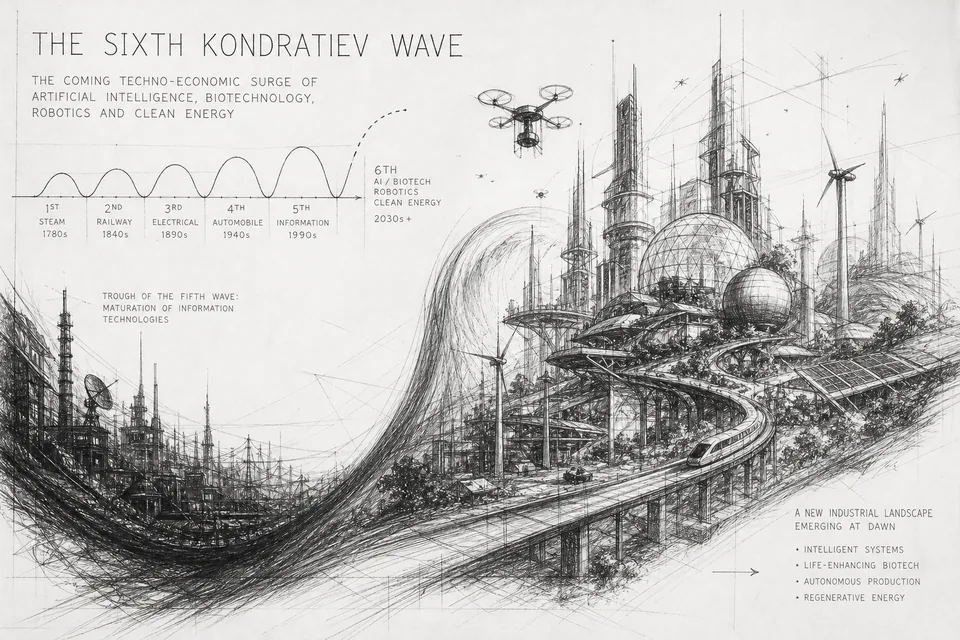

# Convergence Assets

Art library for the Convergence research reports. Monochrome retro-futurist pencil concept art, GPT Image 2.

| Folder | What | Edit? |
|---|---|---|
| `masters/` | Full-res originals: `sheet-*` concept sheets, `*-clean` cleaned heroes, single report heroes | Never. Add only |
| `crops/` | Pieces cut from the sheets (heroes, banners, vignettes, icons, charts) | Add only |
| `upscaled/` | Real-ESRGAN x4plus versions of every crop and sub-1536 hero (65% ESRGAN blended with 35% Lanczos to keep pencil grain). `scripts/upscale.py` | Generated |
| `web/` | WebP at 480/960/1600 px wide (only sizes up to the source width) | Generated |
| `social/` | 1200x630 share cards for every hero | Generated |
| `svg/` | Vector-traced icons and logos, `fill="currentColor"` so CSS sets the colour | Generated |
| `manifest.json` | One entry per asset: report, role, sizes, alt text, file paths | Generated |

Rebuild everything after adding art:

```bash
pip install pillow vtracer
python3 scripts/build.py
```

## Using on the site

```html

<meta property="og:image" content="social/kondratiev-sixth-wave-og.jpg">
<button class="icon"> Chainlink</button>
```

Inline an SVG (rather than ``) when you want `currentColor` to follow text colour or hover states.

## Naming

`<report-subject>-<role>[-variant].png`, e.g. `world-orders-reserve-currency.png`, `waves-icon-train.png`.

## Corrected versions (use these)

- `world-orders-debt-cycle-fixed.png`: tower sign corrected from "SYSTEIEBT" to "SYSTEM EXPANSION" using the image's own letter strokes.

- `master-synthesis-v1-fixed.png`: Big Cycle relabelled ~100-250 yrs and Kondratiev ~50-60 yrs, re-using the image's own lettering. The original `master-synthesis.png` is kept untouched.
- `fourth-turning-archetypes-fixed.png`: Crisis and Unraveling labels swapped so the wheel reads High, Awakening, Unraveling, Crisis in sequence.

## Known flaws

- `fourth-turning-crisis-era.png`: original kept; its wheel has uneven segments. Use `fourth-turning-crisis-era-v2.png`, regenerated with four equal quadrants in clockwise order (High, Awakening, Unraveling, Crisis).

- `evolution-of-money.png`: barter to programmable money, value dematerialising from substance to trust to code.
- `evolution-of-money-river.png`: preferred money hero, one landscape: river of value from barter market to code city.
